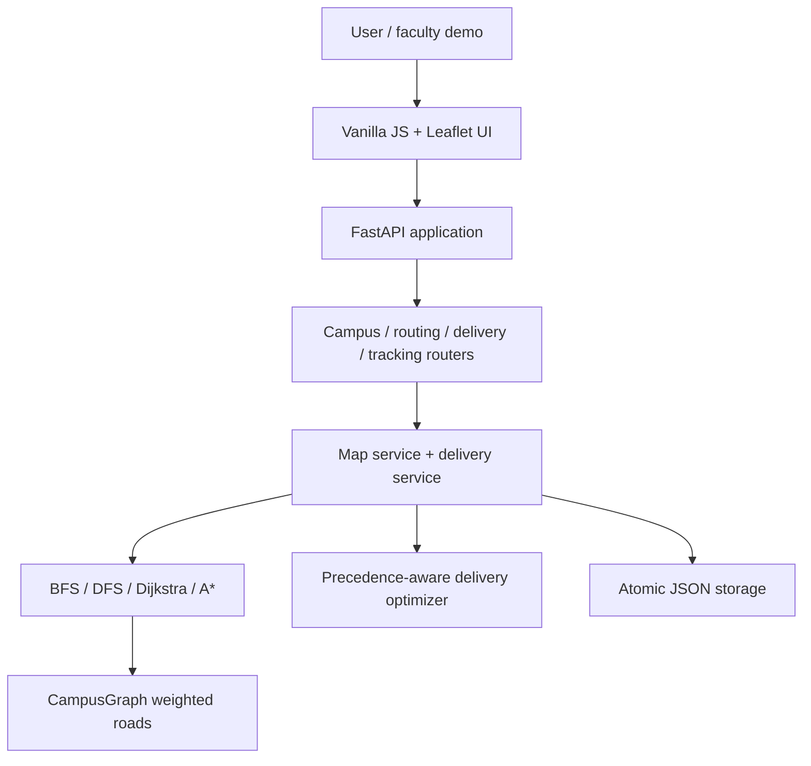
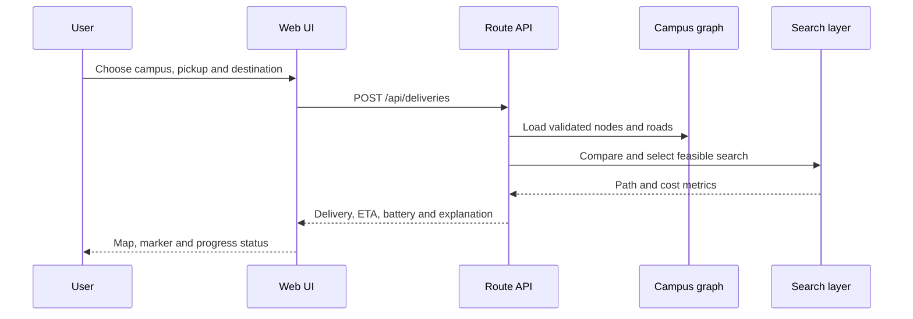

# Architecture

The faculty-fixed algorithm and cost files remain isolated. Routers validate
requests, services resolve campus data, and response models keep the public
JSON contract stable. The API cache is process-local; JSON persistence is safe
against partial writes but is not a multi-node database.
